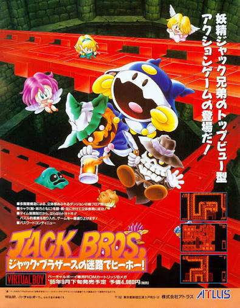
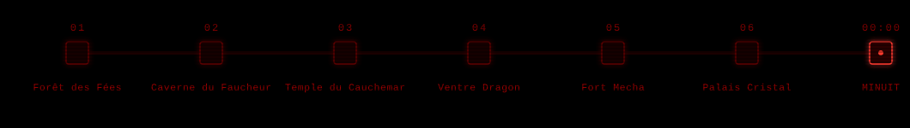

<div align="center">



<br/>

<a href="https://github.com/Grimoire-du-Coeur/JackBros-FR-VB/releases"></a>


<a href="#licence"></a>

<br/><br/>

**Le premier spin-off de la série *Megami Tensei* n'était jamais sorti en français.**<br/>
Il l'est maintenant — les 142 textes du jeu, cinématiques et dialogues de boss compris.

</div>

<br/>

---

## Le jeu

<table>
<tr>
<td width="300" valign="top">



<sub>Publicité japonaise d'origine, Atlus 1995.<br/>« ジャック・ブラザースの迷路でヒーホー！ »</sub>

</td>
<td valign="top">

Automne 1995. **Atlus** sort *Jack Bros.* sur Virtual Boy — l'un des très rares jeux d'action en vue du dessus de la console, et le tout premier spin-off de *Megami Tensei*. Aux commandes : **Jack Frost**, **Jack Lantern** et **Jack Skelton**, les trois mascottes dessinées par **Kazuma Kaneko**.

Les trois frères ont profité d'Halloween pour visiter le monde des humains. Problème : ils ont jusqu'à **minuit** pour retrouver le portail féerique, sinon ils y restent pour toujours. Guidés par la fée Pixie, ils doivent redescendre six mondes truffés de pièges, de clés à ramasser et de boss — jusqu'à Belzoff.

Le jeu n'est sorti qu'au Japon et aux États-Unis. Ce patch traduit **l'intégralité** des textes : écran-titre, menus, cinématiques, indices des fées et dialogues de boss.

</td>
</tr>
</table>

<div align="center">

</div>

<br/>

---

## En images

| Écran-titre | Introduction d'Halloween |
|:---:|:---:|
|  |  |

| Dialogue avec Pixie | Forêt des Fées |
|:---:|:---:|
|  |  |

| Indice en donjon | Astuce sur le Slime |
|:---:|:---:|
|  |  |

<br/>

---

## Appliquer le patch

> [!IMPORTANT]
> **Aucune ROM n'est distribuée ici**, et le patch n'en contient aucun morceau. Vous devez fournir votre propre dump de la ROM américaine.

<div align="center">

</div>

### La ROM attendue

| | |
|---|---|
| **Fichier** | `Jack Bros. (USA).vb` — ou `Jack Bros (U) [!].vb` |
| **Taille** | 1 048 576 octets (1,00 Mio) |
| **CRC32** | `A44DE03C` |
| **MD5** | `EE873C9969C15E92CA9A0F689C4CE5EA` |
| **SHA-1** | `0E086D7EF2BD8B97315196943FD0B71DA07AA8F1` |

Si vos empreintes ne correspondent pas, le patch échouera : votre dump n'est pas la bonne révision.

### Méthode 1 — le patcher web inclus *(recommandé)*

Le dépôt embarque un patcher xdelta3 compilé en WebAssembly. Il tourne **entièrement dans votre navigateur** : rien n'est envoyé nulle part, et il fonctionne hors ligne.

1. Téléchargez `Jack Bros. (USA) [T-Fr v1.0 chenetulipe].xdelta` depuis les **[Releases](https://github.com/Grimoire-du-Coeur/JackBros-FR-VB/releases)**.
2. Double-cliquez sur `patcher/lancer_patcher.bat` — votre navigateur s'ouvre sur le patcher local.
3. Glissez votre ROM et le `.xdelta`, puis cliquez sur **Patcher**.
4. Récupérez `Jack Bros (Fr).vb`.

Un patcher en ligne classique comme [Rom Patcher JS](https://www.marcrobledo.com/RomPatcher.js/) fait aussi bien l'affaire.

### Méthode 2 — recompiler depuis les sources

Pour inspecter les dialogues en JSON, corriger une tournure ou reconstruire la ROM vous-même :

1. Double-cliquez sur `start.bat` à la racine (Python requis).
2. Glissez votre ROM `Jack Bros. (USA).vb` dans l'interface.
3. Cliquez sur **Compiler la ROM**.

> [!TIP]
> Une coquille, un texte qui déborde, un bug d'affichage ? Ouvrez une **[Issue](https://github.com/Grimoire-du-Coeur/JackBros-FR-VB/issues)**.

<br/>

---

## Où y jouer

La ROM patchée tourne partout où tourne un Virtual Boy :

| | |
|---|---|
| **PC** | [Mednafen](https://mednafen.github.io/) — le plus fidèle — ou [RetroArch](https://www.retroarch.com/) avec le core [Beetle VB](https://docs.libretro.com/library/beetle_vb/) |
| **Nintendo 3DS** | [Red-Viper](https://github.com/skyfloogle/red-viper), qui exploite la 3D stéréoscopique de la console |
| **Casque VR** | [VirtualBoyGo](https://github.com/CidVonHighwind/VirtualBoyGo) (Meta Quest, via SideQuest) |
| **Console d'origine** | via une cartouche flash — [FlashBoy Plus](https://www.planetvb.com/), Virtual Boy Pro |

<br/>

---

## Dans les coulisses

Traduire une cartouche de 1995 n'est pas qu'une affaire de vocabulaire. Trois contraintes ont façonné chaque phrase du jeu.

**Chaque réplique vit dans une boîte de taille fixe.** Les 142 textes occupent des emplacements précis de la ROM, avec une taille maximale allouée. Dépasser d'un seul octet, c'est écraser les données voisines. L'introduction d'Halloween, par exemple, tient dans 130 octets — pas 131 :

```diff
- Before long, it is 11:00 o'clock  at night. Halloween will be over
- soon and the portal to the world  of Fairies will soon close.
+ Bientot, 11h00 du soir sonne.
+ Halloween va s'achever et
+ le portail du Monde des Fees
+ va bientot se refermer.
```

**La police de la cartouche n'a pas d'accents.** Ni `é`, ni `à`, ni `ô` : ils n'existent tout simplement pas dans les tuiles graphiques du jeu. C'est pour cela que le français affiché est sans accents — un choix de fidélité au matériel, pas un oubli. Refaire les tuiles aurait demandé de réécrire la table d'assemblage du moteur graphique, au prix de la stabilité.

**Et il n'y a pas de tiret non plus.** Dans la police des dialogues, l'octet `0x3E` ne contient pas `-` mais `#`. Écrire « Bats-le » affichait donc **« Bats#le »** à l'écran. Le bug a été traqué puis contourné en remplaçant les tirets par une espace propre.

Les détails techniques complets — tables de caractères, balises de contrôle, format des tuiles — sont dans **[DOCUMENTATION.md](./DOCUMENTATION.md)**.

<br/>

---

## Contenu du dépôt

```text
JackBros-FR-VB/
├── traduction/
│   └── JackBros_FR.json      # les 142 textes, originaux et traduits
├── patcher/                  # patcher web local, xdelta3 en WebAssembly
│   ├── index.html
│   └── lancer_patcher.bat
├── tool/                     # moteur de recompilation + interface web
│   ├── core_engine.py        #   encodage texte et réinjection en ROM
│   ├── server.py             #   serveur local FastAPI
│   ├── verifier_traduction.py#   valide la traduction, sans ROM
│   ├── test_core_engine.py   #   tests du moteur, sans ROM
│   └── dist/                 #   interface
├── assets/                   # bandeau, schémas, captures
│   └── _src/                 #   générateurs des SVG animés
├── start.bat                 # lance l'outil de recompilation
├── DOCUMENTATION.md          # notes de romhacking sur la ROM
├── CREDITS.md                # crédits et travaux antérieurs
├── LICENSE                   # GPL-3.0 — le code
└── LICENSE-TRADUCTION        # CC BY-NC-SA 4.0 — la traduction
```

<br/>

---

## Crédits

Traduction, rétro-ingénierie et outils : **[chenetulipe](https://github.com/chenetulipe)**.

Ce patch s'appuie sur le travail de la communauté romhacking Virtual Boy — **KR155E** (traduction allemande, 2005), **Max1323** (traduction espagnole, 2019), **Parasyte** (reverse-engineering et Debug Mode), et [Planet Virtual Boy](https://www.planetvb.com/).

Le détail complet est dans **[CREDITS.md](./CREDITS.md)**.

<br/>

---

## Licence

Ce dépôt mêle du code et une œuvre de traduction, qui ne relèvent pas de la même logique :

| Ce qui est couvert | Licence |
|---|---|
| Le code — `tool/`, `patcher/`, scripts | **[GPL-3.0](./LICENSE)** |
| La traduction — `traduction/JackBros_FR.json`, textes du dépôt | **[CC BY-NC-SA 4.0](./LICENSE-TRADUCTION)** |

Le patcher embarque **xdelta3** compilé en WebAssembly, sous sa propre licence (voir [CREDITS.md](./CREDITS.md)).

<br/>

---

## Mentions légales

Travail de traduction bénévole et indépendant, réalisé par des fans à des fins de préservation et d'accessibilité. Ni affilié, ni approuvé, ni soutenu par Nintendo ou Atlus.

*Jack Bros.*, *Shin Megami Tensei* et leurs personnages sont la propriété d'**Atlus Co., Ltd. / SEGA**. La publicité reproduite plus haut appartient à Atlus et n'est montrée qu'à titre documentaire.

<div align="center">
<br/>
<sub><b>Grimoire du Cœur</b> · traductions de jeux oubliés</sub>
</div>
